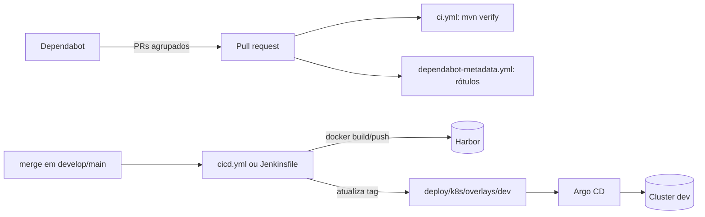

# Architecture overview

> Repo laboratório: um projeto Maven mínimo cercado de automação — Dependabot propõe updates, o CI valida, o CD publica imagem e atualiza o manifest que o Argo CD aplica.

## Flow

## Key classes / entry points

| Arquivo | Papel |
|-------|------|
| `.github/dependabot.yml` | Agenda, grupos e prefixos dos updates |
| `.github/workflows/ci.yml` | `mvn verify` em PRs |
| `.github/workflows/cicd.yml` / `Jenkinsfile` | Testa → imagem no Harbor → atualiza manifest dev |
| `.github/workflows/release.yml` | Release |
| `deploy/k8s/`, `deploy/argocd/` | Manifests Kustomize e Application do Argo CD |

## Related

- [[pipeline-cicd-gitops]], [[dominio-dependabot]], [[decision-sem-codeql]]
